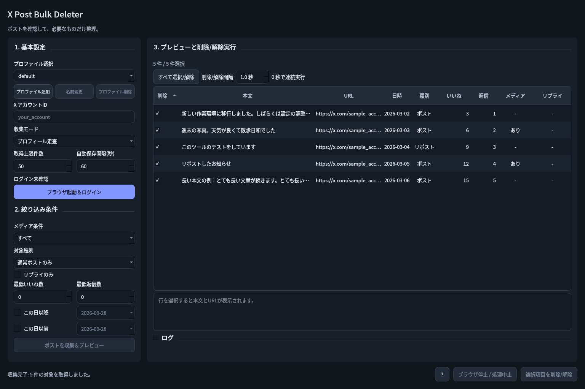

# kusamushiri（草むしり）🌱

X (Twitter) アカウントを手入れするデスクトップアプリです。

[English](README.md) | 日本語

自分の X アカウントのポストをまとめて削除・リポスト解除できます。
ブラウザ自動操作 (Playwright) と GUI (Qt / PySide6) で、条件に合うポストを **一覧で確認してから** 削除できます。



> [!WARNING]
> - **削除したポストは元に戻せません。** 実行前に一覧をよく確認してください。必要なら先に X の「データのアーカイブ」をダウンロードしておくことをおすすめします。
> - 本ツールは X Corp. とは無関係の非公式ツールです。ブラウザの自動操作は X の利用規約に抵触する可能性があり、アカウントが制限される場合があります。**自己責任でご利用ください。**
> - パスワードやログイン情報をツールが扱うことはありません。ログインは表示されたブラウザ上で手動で行い、ログイン状態はお使いの PC 内にのみ保存されます。

## 主な機能

- 期間・いいね数・返信数・メディア有無・リプライのみ・キーワード（含む/除外） などの条件でポストを絞り込み
- 通常ポストの削除とリポストの解除に対応
- いいねの取り消し: プロフィールのいいね欄から収集し、チェックしたポストのいいねを取り消し
- 実行前に一覧・本文プレビューで確認し、チェックした項目だけを実行
- チェックした項目を削除前の控えとして CSV / JSON に保存
- X の「データのアーカイブ」からポストを読み込み、検索で見つからない古いポストも対象に（このアプリで削除済みのポストは除外、古い順にも対応）
- 実行間隔の調整、速やかな中止、安全な失敗への回数制限付き再試行と未処理分の再開
- 複数アカウント（プロファイル）の切り替え
- フォローリストを CSV（Excel 対応）または JSON で書き出し
- フォロー中のアカウントを一覧で確認し（相互フォローは除外可能）、チェックしたものだけフォロー解除
- チェックしたフォロー中アカウントの最終ポスト日を取得し、取得日とともにプロファイルごとに記録・並べ替え

## インストール

### ビルド済みアプリ（おすすめ）

[Releases](https://github.com/kw4r3n/kusamushiri/releases) から OS に合ったファイルをダウンロードして展開します。

| OS | ファイル | 起動方法 |
|---|---|---|
| Windows | `kusamushiri-windows-x64.zip` | 展開した `kusamushiri` フォルダ内の `kusamushiri.exe` |
| macOS (Apple Silicon) | `kusamushiri-macos-arm64.zip` | `kusamushiri.app` |
| Linux | `kusamushiri-linux-x64.tar.gz` | 展開した `kusamushiri/kusamushiri` |

- 初回の「ブラウザ起動」時に Chromium（約 150MB）を自動でダウンロードします。
- アプリは署名されていないため、初回起動時に警告が出ることがあります。
  - Windows: SmartScreen で「詳細情報」→「実行」
  - macOS: `.app` を右クリック →「開く」。それでも開けない場合は `xattr -dr com.apple.quarantine kusamushiri.app`

### ソースから実行

[uv](https://docs.astral.sh/uv/) を使います（Python 3.11 は uv が自動で用意します）。

```bash
git clone https://github.com/kw4r3n/kusamushiri.git
cd kusamushiri
uv run kusamushiri
```

`start-kusamushiri.bat`（Windows）/ `start-kusamushiri.sh`（Linux/macOS）をダブルクリックしても起動できます。
pip の場合は `pip install .` のあと `kusamushiri` で起動します。

## 使い方

1. アプリを起動します。GUI が開いたら、必要な情報（対象のXアカウントID、絞り込み条件、対象種別など）を入力してください。
2. 「ブラウザ起動＆ログイン」ボタンを押し、表示されたブラウザ上で手動でXにログインしてください。
3. ログイン確認時に、現在ログイン中のアカウント名が取得できた場合は入力欄との差分を警告します。入力欄が空なら自動で補完されます。
4. 「ポストを収集＆プレビュー」を押すと、設定した条件に基づいて対象ポストが収集・一覧表示されます。
5. 「メディア条件」で「画像・動画なしのみ」を選ぶと、画像・動画を含まないポストだけを一覧化できます。
6. 「対象種別」で「リポストのみ」または「通常ポスト + リポスト」を選ぶと、リポストも一覧化できます。リポスト行を実行すると削除ではなくリポスト解除を行います。
7. 「投稿日」で「この日以降」「この日以前」を個別に指定できます。両方を有効にすると、指定期間内のポストだけを対象にできます。日付はどちらも指定日を含み、PC のタイムゾーン（日本なら JST）の日付で判定します。
8. 「含むキーワード」を指定すると、いずれかのキーワードを本文に含むポストだけを一覧化します。「除外キーワード」に一致するポストは一覧に入りません（残したいポストの保護に使えます）。複数指定はカンマ（`,` または `、`）区切りで、大文字/小文字と全角/半角の違いは区別しません。判定はタイムラインに表示された本文で行うため、「さらに表示」で折りたたまれた部分は対象外です。
9. 「削除/解除間隔」で各項目の実行間隔を秒単位で調整できます。`0 秒` にすると待機なしで連続実行します。
10. リストから実行したい項目にチェックを入れ（または全選択し）、「選択項目を削除/解除」ボタンを押して実行してください。
11. 停止した場合は詳細を確認して残りの項目を再開できます。安全に再送できる失敗だけ自動で再試行し、結果不明は保留します。

## 診断ログを共有する

診断ログは自動で有効になります。ローカルのtrace・対象・試行・操作・遷移・要求ID、
安全な通信先名とメソッド、要求イベント／応答時刻、HTTP状態、解析したRetry-Afterを記録します。
`origin_operation` は要求開始の記録に対応する操作、`operation` は応答到着時に進行中の操作です。
再試行をまたぐ遅延応答では異なる値になります。要求記録がない・保持範囲外・開始時刻が現在の操作より古い場合は、
現在の操作へ推測で割り当てず不明として表示します。記録は時刻の対応であり、JSの発行元や制限の共有範囲を確定しません。
送信の有無、削除要求ID、保留・結果不明・認証関連の結果、GraphQLコード88を記録し、エラー本文や応答本文はコピーしません。

この版で意図した通常操作を試した後、最新のtraceを次のコマンドで取り出せます。

```nu
uv run kusamushiri-cli diagnostics | save -f kusamushiri-diagnostic.jsonl
```

共有するのはこのJSONL抜粋です。認証情報・URL全文とクエリ・ポストID・ポスト／応答本文・従来の一般ログ行は含めません。
アプリログ全文は共有しないでください。必要なら `diagnostics --trace <12文字のID> --max-events 1000`、
別ログなら `--log PATH` を指定できます（直近3世代のローテーションも読めます）。要求の保持件数には上限があり、失われた対応は不明のままです。
このコマンドはログの読み取りだけで、ブラウザを起動しません。
最初の429／保留を調べる場合は、その表示が出た時点でCtrl+Cで中断できます。診断のために長い休止を完走する必要はありません。
中断と保存済み期限は引き続き尊重します。診断の追加による通信・待機や、利用制限ポリシーの変更はありません。

## コマンドライン版（半自動化）

ダウンロードしたファイルには `kusamushiri-cli` も入っています（Windows: `kusamushiri-cli.exe`、macOS: `kusamushiri.app/Contents/MacOS/kusamushiri-cli`、ソースから: `uv run kusamushiri-cli`）。追加のインストールは不要です。

### かんたんな使い方: 一度質問に答えれば、あとは繰り返すだけ

`kusamushiri-cli` を引数なしで起動します（Windows では `kusamushiri-cli.exe` をダブルクリック）。プロファイル、条件（「30 日より前」「残したいキーワード」など）、削除まで行うかを質問形式で聞き、`kusamushiri.toml` に保存して次の流れで実行します。

1. 必要ならログイン（初回はブラウザのウィンドウが開きます）
2. 条件に合うポストを集め、一覧を `kusamushiri-lists/posts-<日時>.csv` に保存
3. 先頭数件を表示し、削除してよいか確認。答える前に CSV の行を消すと、その行は対象外になります（ファイルに残った行だけを実行）

次回は起動すると保存済みの設定を使うか聞かれます。`kusamushiri-cli run kusamushiri.toml` でも実行できます。設定を複数使い分けるとき（古いポスト用といいね用など）は「新しい設定を作る」を選んで `likes` のような名前を付けると `kusamushiri-likes.toml` に保存され、次回からは今のフォルダにある `kusamushiri*.toml` の一覧から選べます。`kusamushiri-cli run kusamushiri-likes.toml` で直接実行もできます。設定ファイルはコメント付きのテキストなので、エディタで条件を変えられます。`[delete]` を書かなければ一覧の保存だけを行い、`[delete]` に `confirm = false` を書くと確認なしで実行します（定期実行向け）。アーカイブから読むときは `[collect]` の `order = "oldest"`（古い順）または `"newest"`（新しい順）で順番を指定できます。

### 今の設定を保って不足項目を追加する

アプリの更新や通常の読み込みではTOMLを書き換えません。古い設定も、省略した項目には
現在の既定値を使って読み込めます。その値を設定ファイルにも明示したい場合は、次のコマンドを使います。

```nu
cd /path/to/kusamushiri
^.venv/bin/python -m kusamushiri.cli update-recipe kusamushiri-omote-post.toml --dry-run
^.venv/bin/python -m kusamushiri.cli update-recipe kusamushiri-omote-post.toml
```

インストール済み／配布版では `kusamushiri-cli update-recipe FILE [--dry-run]` です。
ファイル名を省略すると `kusamushiri.toml` を使います。どちらも差分を表示します。
`--dry-run` は設定とバックアップを書き込みません。実際の更新では、上書きしない
`FILE.bak-<UTC時刻>` バックアップを作り、検証済みの内容でファイルをアトミックに置き換えます。
再度実行しても変更やバックアップは増えません。元のテキストに戻す場合に備えてバックアップを残してください。

追加するのは、現在の既定値が具体的に決まっている不足項目だけです。既存の値・コメント・記述順、
インラインテーブル・ドット記法、旧キー `oldest_first` を残します。存在しない `[delete]` は追加せず、
未指定の `profile`・`archive`・`user`・日付などに値を設定しません。既定値を明示すると、その値に固定されるため、
今後アプリの既定値が変わっても自動では変わりません。未知の項目は削除せず報告しますが、通常の読み込みでは引き続きエラーになります。
不正なTOML・対応項目の不正な値・矛盾する旧新キー・シンボリックリンク・更新中の他の編集は検出して中止します。
ブラウザ起動・アカウントデータ移行・収集・削除は行いません。
質問形式のウィザードで設定を作り直すとファイルとコメントを上書きするため、保持する場合は `update-recipe` を使ってください。

今のフォルダにある保存済みレシピをまとめて確認・更新する場合は `--all` を使います。

```nu
^.venv/bin/python -m kusamushiri.cli update-recipe --all --dry-run
^.venv/bin/python -m kusamushiri.cli update-recipe --all
```

探索範囲はウィザードと同じ、現在のフォルダ直下の `kusamushiri*.toml` だけです。
`kusamushiri.toml` を先頭に表示し、サブフォルダや `pyproject.toml`、`examples/delete-tuning.toml` は探索しません。
シンボリックリンクと、末尾の `.toml` より前にドット区切りで `toml`・`bak`・`backup`・`tmp`・`temp`・`new`・
`updated`・`generated`・`preview`・`candidate`・`review` を含むコピーを除外します。大文字小文字を区別せず、
これらに `-`／`_` で時刻などを付けた名前も除外します。
たとえば `kusamushiri-old.new.toml` は除外し、保存名 `kusamushiri-new.toml` は含めます。
一致した正確なパス一覧と各ファイルの差分・変更不要の結果を表示します。`--all` と個別のファイル指定は併用できません。

書き込み前に全対象を検証し、不正な設定が一つでもあればバックアップも作らず全体を中止します（終了コード2）。
探索・書き込みの失敗は終了コード1です。途中の書き込みに失敗した場合は停止し、更新済みファイルとそのバックアップ、
失敗したファイル、未処理件数を報告します。先に成功した更新は保持します。各ファイルは個別にバックアップし、アトミックに更新します。
対象0件・更新完了・プレビュー成功の終了コードは0です。再実行しても不要なバックアップは増えません。

### 個別のコマンド

```bash
kusamushiri-cli login --profile main                 # 開いたブラウザで一度だけ手動ログイン
kusamushiri-cli collect --profile main --headless --older-than 30 --exclude 残す -o posts.json
kusamushiri-cli archive twitter-archive.zip --profile main --order oldest -o old.json
kusamushiri-cli delete posts.json --profile main --headless --dry-run   # 対象の表示のみ
kusamushiri-cli delete posts.json --profile main --headless --interval 3 --failed-output failed.json
kusamushiri-cli following --profile main --skip-mutual -o follows.csv
kusamushiri-cli last-posts follows.csv --profile main -o follows.csv
kusamushiri-cli unfollow follows.csv --profile main --headless
```

- 一覧はアプリが書き出すのと同じ CSV / JSON で、プロファイルもアプリと共通です。
- `login` は常にウィンドウを表示します。ほかのコマンドは `--headless` でウィンドウなしで動き、未ログインなら中止します。ヘッドレスの Chromium は `HeadlessChrome` と名乗るため X に別扱いされることがあり、うまくいかない場合は `--headless` なしで試してください。
- `delete` と `unfollow` は実行前に確認します。無人で実行するときは `--yes` を付けてください。Ctrl+C で現在の項目の後に停止し、もう一度押すと即中断します。
- 削除・解除は新しく完了した25件ごとに初期値120秒で通信を休止し、HTTP 420/429では制限に従って待機します。安全に再試行できる失敗だけ回数と総待機時間の上限付きで再試行し、認証・権限・恒久エラーと結果不明は停止します。`--failed-output` は失敗と未処理を保存します。詳細は下記「削除処理の待機・再試行」を参照してください。
- 終了コード: 0 成功、1 一部失敗、2 入力エラー、130 中断（利用制限による停止を含む）。各オプションは `kusamushiri-cli COMMAND --help` で確認できます。

## 開発

テスト・ビルド方法は [CONTRIBUTING.md](CONTRIBUTING.md) を参照してください。

## 補足

- GUI はダークテーマを標準で使用します。左側でプロファイル・条件を設定し、右側の一覧と本文プレビューで対象を確認できます。
- 設定欄は独立してスクロールでき、画面下の停止・削除操作は常に表示されます。選択件数は一覧上部に表示され、ログは必要なときに展開できます。処理中に停止すると、ブラウザの停止が完了するまで操作はロックされ、成功・失敗・未処理の件数がステータス欄に表示されます。
- 表示言語は日本語（標準）と英語から選べます。画面下の言語メニューで切り替え、アプリを再起動すると反映されます。
- デザインと画面例: [GUIデザイン](docs/design/gui-design.md)。
- 入力した条件と削除/解除間隔は次回起動時に復元されます。
- **複数アカウント対応**: GUI の「プロファイル追加」から名前を入力すると、新しい独立したブラウザプロファイルが作成・選択されます。追加後は「ブラウザ起動＆ログイン」でそのプロファイルに手動ログインしてください。既存のプロファイルは「プロファイル選択」から切り替えられ、ログイン状態と設定（フィルタ、取得上限など）は個別に保存されます。
- ブラウザ停止中は「名前変更」「プロファイル削除」を利用できます。削除するとそのプロファイルのログイン情報と設定が消えますが、Xのアカウントやポストは削除されません。`default` は名前変更・削除できません。
- ログイン確認後は、基本設定にログイン中のXアカウントを表示します。
- 削除処理は「…」ボタンと削除項目の描画を待ち、失敗した段階を表示します。「削除確定後の完了確認」で失敗した場合は結果不明のため、再試行前にX上で確認してください。自動で削除を繰り返すことはありません。
- 高度な検索は読み込み中に空と決めつけず、最大15秒待機します。一時的な投稿解析エラーは、スクロール前に最大3回試します。中止操作と収集の安全上限は維持します。
- ブラウザプロファイルはユーザー環境のデータディレクトリ（例: Windows は `%LOCALAPPDATA%\kusamushiri`、Linux は `~/.local/share/kusamushiri`）に保存されます。アカウントごとに `chromium-profile-{アカウント名}` という独立したプロファイルが作成されます。
- ログはユーザー環境のログディレクトリに保存されます。不具合報告の際に添付してください（個人のポスト内容が含まれる場合があるので確認のうえ共有してください）。

## 注意事項

- X の仕様変更（画面構成の変更）により、正常に動作しなくなる可能性があります。動かなくなった場合は Issue で報告してください。
- 短期間に大量のポストを削除すると、アカウントが制限される可能性があります。削除/解除間隔は余裕をもって設定してください。
- ブラウザ操作は自動で行われるため、実行中は表示されたブラウザを操作しないでください。

## 通常の削除設定

新しい設定テンプレートの削除項目は2つです。

```toml
[delete]
interval = 3.0
confirm = true
```

通常は項目間隔だけを調整し、取り消せない操作の確認を残します。残り10項目は高度な互換設定として
同じ優先順位（CLI → TOML → 初期値）で読み込みます。初期値と同じ値も、既存ファイルで明示した値は保持します。
役割の異なる操作再試行・定期休止・全体制限待機を無理に統合せず、廃止キーや別のプリセットは追加しません。
テンプレートは既定の高度設定を省略し、`update-recipe` / `--all` もそれらを追加し直しません。
既存の値・コメントを削除したり、ファイルを自動で整理したりしません。
通常の `delete --help` / `run --help` は間隔・総待機上限・周辺通信モードを表示します。
他の8個の調整フラグも引き続き受け付け、下の高度設定一覧で確認できます。

<details>
<summary>高度な互換設定と安全動作</summary>

## 削除処理の待機・再試行

この説明は現在のソース／未リリース変更に対応しています。既存の配布バイナリへ自動反映はされません。
実行するCLIの `--help` を確認し、必要ならこのチェックアウトのソースから起動してください。
例のコマンドは環境準備済みのリポジトリ内で実行します。
[examples/delete-tuning.toml](examples/delete-tuning.toml) に説明付きの設定例を用意しました。
既存の `[delete]` を重複させずキーを移してください。例は控えめな8秒間隔で、初期値は3秒のままです。

新しい初期値は項目間隔3秒、完了を確認した25件ごとに120秒休止です。Xで安全と確認された
閾値ではなく、控えめな出発点です。既存の設定ファイルやGUIに明示して保存した値は保持します。
GUIの「待機・再試行設定」、CLIの `delete` / `run`、設定ファイルの `[delete]` で調整できます。

削除API・対象読込・周辺通信（`fleetline` / `ViewerBadgeCounts` / `CreatorStudioTabBarItemQuery` / `account/settings.json`）・分類不能な通信の429を
区別して記録します。ただし役割の分類であり、Xの利用制限枠が別だと断定するものではありません。
既定の `global` モードでは、いずれのHTTP 420/429も全体の通信休止の契機にします。送信前に止めた削除は失敗に数えず、未処理として
保持します。削除の再試行回数と通信休止回数は独立しています。

通信休止は初期値で最大3回、120・240・480秒です。安全に再試行できる実際の操作失敗は
別に最大3回、60・120・240秒で再試行します。制限後や保存された休止からの再開後は項目間隔を最低5秒、指定値が長ければ
その値になります。認証・権限・恒久エラーと、送信後の結果不明は再送せず停止します。

長い休止中はブラウザ全体を一時的にオフラインにし、新しい周辺通信がXへ届き続けないようにします。
既に送信済みの要求や遅れた通知は届く場合があるため、待機中も通知を処理します。
`Retry-After` の秒数・HTTP日付を尊重し、新しい通知があれば期限を延長します。
通常の待機増加上限900秒を超えても短縮しません。総待機上限1800秒を超える場合は停止して
ブラウザの通信休止と期限を保持します。項目間隔・定期休止は総待機上限の対象外ですが、
その休止中に利用制限を検知した待機は対象に含めます。

Ctrl+C／中止ボタンで待機を速やかに中断できます。理由と期限を実行記録に保存し、
期限前のブラウザ再起動は接続前に止めます。期限後に明示的に起動・再開してください。
勝手に処理を再開することはありません。完了した項目は再実行せず、`--failed-output` は
失敗と未処理の両方を保存します。

CLIフラグと設定ファイルのキーは次の対応です：

| `[delete]` | CLI | 単位 | 初期値 |
|---|---|---|---:|
| `interval` | `--interval` | 項目間の秒数 | 3 |
| `confirm` | `run` のTOML設定。直接の `delete` は明示的な `--yes` | 真偽値 | true |
| `batch_size` | `--batch-size` | 新しく完了を確認した件数 | 25 |
| `batch_pause` | `--batch-pause` | 秒 | 120 |
| `max_retries` | `--max-retries` | 項目ごとの追加操作再試行回数 | 3 |
| `retry_delay` | `--retry-delay` | 秒 | 60 |
| `retry_max_delay` | `--retry-max-delay` | 秒 | 900 |
| `retry_max_wait` | `--retry-max-wait` | バッチ全体の秒数 | 1800 |
| `max_cooldowns` | `--max-cooldowns` | バッチ全体の通信休止回数 | 3 |
| `cooldown_delay` | `--cooldown-delay` | 秒 | 120 |
| `rate_limit_interval` | `--rate-limit-interval` | 制限後の最低項目間隔（秒） | 5 |
| `ancillary_rate_limit_mode` | `--ancillary-rate-limit-mode` | global / isolate-known | global |

`global` は従来の動作を保つ既定値です。キーのない既存TOML、新しい設定テンプレート、
ウィザード、GUIもこの値を使います。今回だけ個別休止を選ぶには、ソースCLIの `delete` / `run` に
`--ancillary-rate-limit-mode isolate-known` を追加します。保存する場合は既存の `[delete]` 内へ
`ancillary_rate_limit_mode = "isolate-known"` を指定します。TOMLは自動変更せず、
変更していないウィザード設定は `global` のままです。
この未リリース機能は、停止・保存処理の修正に対する独立再レビュー待ちです。
確認は `--dry-run` のまま行い、再レビューが済むまで実操作への有効化は保留します。

個別休止の対象は `x.com` / `twitter.com` のHTTPS GETのうち、
`/i/api/graphql/<hash>/ViewerBadgeCounts`・`/i/api/graphql/<hash>/CreatorStudioTabBarItemQuery` と `/i/api/fleets/v1/fleetline?only_spaces=true`（このクエリのみで、他のパラメータを含まないもの）、
および `api.x.com` / `api.twitter.com` の `/1.1/account/settings.json` だけです。
HTTP 420/429を受けた通信先への次の要求をローカルで止め、コンテキスト終了まで再送しません。
期限が過ぎても自動再送せず、成功応答も捏造しません。別のfleetlineパス・クエリ、GET以外、
不明な通信先、対象読込、削除APIは従来の全体休止を保ちます。対象DOM、通常の操作UI、
削除の成功応答、DOMでの完了確認が必要で、依存する表示が欠ければ停止します。
利用制限枠が別であることや、削除可能であることを保証する設定ではありません。

個別制御を保証するため、新しいコンテキストでService Workerを無効にします。
明示的に選んだCLIはこの条件で起動します。期限を永続保存できるロック付き実行記録も必要です。
保存先がない場合、既存コンテキストやルーティング登録失敗では
`global` に戻します。PlaywrightのルーティングはコンテキストのHTTPキャッシュも無効にします。
要求の中断が失敗した場合、または1件の処理中にローカルで128回の要求を止めた場合は、期限を保持して停止します。
送信済みの応答は引き続き観測し、診断の元要求ID・操作IDは保持します。
診断には個別休止・要求抑止・全体休止への復帰イベントを追加します。
削除APIの420/429、GraphQLコード88、認証・ロック、結果不明、中止、再試行上限は保持します。
成功を確認した削除を取り消したり、再送したりしません。
削除応答のJSONを読めない場合や、オブジェクト以外の場合は、DOM上で完了したように見えても
結果不明とし、成功記録・自動再送はしません。読取可能なオブジェクトは従来のAPIエラーなし・DOM確認を
使いますが、サーバーの応答スキーマ全体を検証するものではありません。
個別休止後の後続項目で必要な表示・操作UIを確認できなければ、追加のサーバー429がなくても
直ちに停止します。対象ページの再読込を増やして再試行しません。
個別休止は削除・解除バッチの範囲だけで使い、起動・ホーム表示・収集時は全体休止を保ちます。

429を観測した時点で、処理を続ける前に休止期限を同期保存します。POSIX環境ではファイルと
親ディレクトリを同期し、書込途中の強制終了は事前に永続化した実行記録のロックで保護します。
該当通信先の休止期限は `cooldown_delay` 以上で、より長い `Retry-After` の秒数・HTTP日付も守ります。
`retry_max_delay` で短縮しません。実際に待機していない個別休止は総待機上限を消費せず、
制限後の項目間隔は設定した最低値を保ちます。完了・中止・エラー時に期限が残っていれば
`action-progress.json` へ保存し、ブラウザをオフラインにします。期限前の再起動は
`global` に戻しても拒否します。他の全体休止は従来の回数・総待機上限に従います。
`max_cooldowns = 0` を指定した場合は、個別休止モードでも全ての制限を全体休止として扱います。
保存に失敗した場合は中止してロックを残し、期限を書けなかった場合も次のブラウザ起動を拒否します。
全ジョブを停止し、保存先と実行記録を確認してからロックを修復してください。失敗時のロックは自動削除しません。
通信制御に失敗した場合は、先に中止と全体停止を確定させてからオフライン化・コンテキスト終了を試みます。
失敗したオフライン化を成功と表示せず、そのコンテキストでの追加操作を禁止します。

少数の確認済みリストをNushellで事前確認する例です：

```nu
uv run kusamushiri-cli delete "reviewed-small.csv" --recipe "kusamushiri-cleanup.toml" --profile "YOUR_PROFILE" --ancillary-rate-limit-mode isolate-known --dry-run
```

独立再レビュー待ちの間は `--dry-run` を保持してください。保存済み診断は
`uv run kusamushiri-cli diagnostics | save -f kusamushiri-diagnostic.jsonl` で取り出せます。

### 通信の許可リスト（試験中）

`--traffic-policy` / `[delete].traffic_policy` は、削除・解除バッチ中の通信を名前で判定します。
既定は `off` で、従来どおり何も変えません。起動・ログイン確認・ホーム表示・収集は対象外です。

- `report`：通信は止めず、要求ごとに「許可／遮断」の判定を診断へ記録します。
  通常の診断が記録しない twimg などの静的配信ホストも、ホスト種別だけを記録します。
- `enforce`：許可リストにない要求をブラウザ側で中断します。Service Workerを無効にした
  新しいコンテキストが必要で、復元されたタブは閉じてから始めます。ルーティングを用意できない場合は
  制限なしに戻さず、1件も処理しません。

許可するのは、対象投稿のページ本体（`/<user>/status/<id>` のGET）、`x.com` と `*.twimg.com` の
スクリプト・スタイル・フォント、GraphQLの `TweetDetail` / `TweetResultByRestId` のGET、
確認ボタンを押す段階での `DeleteTweet` / `DeleteRetweet` / `UnfavoriteTweet` 1回だけです。
GraphQLのクエリIDやスクリプトのファイル名では判定しないため、X の通常の更新では止まりません。
ただし必要な通信の名前が変わったり、新しく必要な通信が増えたりすると止まります。

`enforce` で、削除要求を送る前に失敗した項目は「通信拒否」として保留し、バッチを停止します。
止めた通信が原因かどうかは区別できないため、すでに削除済みの投稿でも停止します。
`diagnostics --summary` の `traffic` に、判定・規則・ホスト種別ごとの件数が出ます。
テレメトリなどを止めるため、通常のブラウザとは異なる通信の出方になります。X がこれをどう扱うかは不明です。
実アカウントでの検証は未実施です。まず `report` で記録し、少数の投稿で `enforce` を試してください。

`max_cooldowns` はバッチ全体で累積し、再開に成功しても、その後削除が成功しても戻りません。
`max_retries` は項目ごとの安全な操作再試行であり、未送信の制限保留には使いません。
保存済み休止からの再開待機も `retry_max_wait` の対象です。通常の項目間隔と制限のない定期休止は
対象外ですが、定期休止中に制限を受けた待機は対象になります。
`rate_limit_interval` は最低値です。項目間隔を8秒にした場合、制限後に5秒へ短縮しません。

`max_retries = 0` は操作の自動再試行を、`max_cooldowns = 0` は制限後の再開を無効にします。
`batch_size = 0` は定期休止を無効にします。再試行・通信休止回数は整数0〜20、件数は整数0〜10000です。
`interval` は有限の0以上（0で通常の間隔をなくす）、その他の待機・上限秒数は有限の正数で、待機増加上限は
両方の初期待機以上にしてください。回数を増やすだけで制限解除を確認したことにはなりません。
制限が繰り返される場合は項目間隔や休止を長くし、休止上限では停止してください。

`run TOMLファイル` と `delete リスト --recipe TOMLファイル` は既存のローダーと `[delete]`
を共用します。優先順位は **明示したCLIフラグ → TOMLの値 → 初期値** です。
`run --interval` でも項目間隔を今回だけ上書きでき、設定ファイルは書き換えません。
`[delete]` のない収集専用設定に上書きフラグを指定しても、削除は有効化しません。

使用中の `kusamushiri-<名前>.toml` を選び、既存の `[delete]` 内で値を変更・不足キーを追加してください。
同じ `[delete]` やキーを二重に追加しないでください。例えば項目間隔だけを8秒に調整し、
回数上限を据え置く場合は次の形です（他のフィルター・プロファイル設定は保持します）：

```toml
[delete]
interval = 8.0
confirm = true
batch_size = 25
batch_pause = 120.0
max_cooldowns = 3
cooldown_delay = 120.0
rate_limit_interval = 5.0
max_retries = 3
retry_delay = 60.0
retry_max_delay = 900.0
retry_max_wait = 1800.0
ancillary_rate_limit_mode = "global" # 明示的に選ぶ場合は "isolate-known"
```

`delete --recipe` は待機・再試行値だけを読み、指定した確認済みリストを対象にします。
収集フィルター・プロファイル・headless・確認省略はTOMLから引き継ぎません。
必要な場合は従来の `--profile`、`--headless`、明示的な `--yes` を指定します。
`--recipe` がなければ従来どおりCLIフラグと初期値を使います。
`run` は既存の収集・プロファイル・確認設定を保持します。

`run` に `--dry-run` はありません。Nushellでブラウザを起動しない確認をする場合：

```nu
^.venv/bin/python -m kusamushiri.cli delete "/path/to/reviewed-posts.csv" --recipe "kusamushiri-cleanup.toml" --dry-run
```

確認のみで、ブラウザ起動・プロファイル移行・待機・実行記録の保存は行いません。
GUIは待機関連の入力項目をプロファイル設定として保存しますが、TOMLとは自動同期しません。
`action-progress.json` の完了記録・安全な休止期限は実行状態であり、TOMLの設定値ではありません。
TOML／CLIの変更でその期限を消したり、`Retry-After` より早く再接続したりすることはありません。

実行記録 `action-progress.json` は各プロファイル内にあり、ID・操作種別・状態・休止理由と期限を
保存します。送信前の `inflight` がクラッシュで残れば結果不明として保留し、未送信と確認できた
制限停止は `pending` として再開できます。認証・恒久エラー・結果不明の解除は、Xで該当項目を
個別に確認し、全ジョブを停止して記録をバックアップしてから該当エントリーだけを修正します。
待機期限・他の記録は保持し、記録全体を消して再実行しないでください。
詳細と確認用の例は [英語README](README.md#wait-and-retry-settings) を参照してください。

### 33件・66件で停止した場合の読み方

33件・66件は診断例であり、X側の削除上限を示す根拠にはなりません。確認したパターンでは、33件成功後の
周辺通信 `fleetline` の429に対して120・240・480秒の通信休止を使い、その後66件まで成功しました。
67件目の送信前に再び429が発生したとき、バッチ全体の3回を既に使っていたため停止しています。
再開に成功しても通信休止回数はリセットされず、67件目は失敗・結果不明ではなく `pending`（未処理）です。
以前の33件停止は送信前の保留が続いたケースで、いずれもサービスの制限枠が独立している証拠にはなりません。

ログの停止理由を確認してください。操作再試行上限・通信休止回数上限・総待機時間上限は別です。
初期値の通信休止3回は計840秒なので、1800秒に達する前でも回数上限で止まります。
有効な `Retry-After` がなければ、保存された将来期限はアプリの次回待機見積もりであり、
その時刻にXの制限が必ず解除されることを示しません。成功件数だけで判断せず、発生元と理由・実行状態を見ます。
調整は項目間隔を5秒から8秒にするなど一つずつ行い、停止上限を保持して次の手動確認で見直してください。
回数を増やす・再起動を繰り返すだけでは解除を確認できず、新しい実行でも過去の完了記録・期限を尊重します。

</details>

## ライセンス

[MIT](LICENSE)

## 無駄な再読込と診断の改善

通信制限・中止を、ページ遷移前とメニュー操作前にも確認します。同じポストを未送信で保留し、
原因が既知の周辺通信GET（上記の個別休止の対象）だけの場合は、期限を守ってから表示を再利用できます。
同じページとURL、唯一の見える対象記事、同一の接続済みDOM、開いたダイアログ・メニューがないことを確認します。
未知・対象読込・削除APIの制限には適用しません。表示が変われば未処理のまま止め、再読込や削除はしません。
追加設定はありません。

48件の保存済みパターンを未知429が続く条件で模擬すると、48件成功・452件未処理は保持しつつ、
停止前の不要なメニュー操作8回を省けました。既知の補助通信の模擬ケースでは、再読込2回・対象読込6件が
1回・3件になり、待機期限と削除要求1回は維持します。実環境で数百件できることを示す結果ではありません。

診断は固定の資源種別・通信種別・trace内の通信先グループ・許可済みAPI名を追加します。
許可リスト外の名前は匿名のままで、名前が表示されても未知通信の停止条件や制限枠を変更しません。
URL全文・クエリ・ポストID・認証情報・本文・未知の通信名は出力しません。
`package_source_sha256` はtrace開始時のパッケージファイルの指紋で、メモリ上のホット更新版を保証しません。
古い記録に保存されなかった情報は復元できません。

```nu
uv run --offline --no-sync kusamushiri-cli diagnostics --summary | save -f kusamushiri-diagnostic-summary.json
uv run --offline --no-sync kusamushiri-cli diagnostics --max-events 1000 | save -f kusamushiri-diagnostic.jsonl
```

集計は残っているローテーションログ全体を使い、trace開始の欠落も示します。未送信保留・安全な再試行・
休止回数・待機時間・停止理由を分けます。予期しないエラーでも完了済み結果を保持し、結果不明の現在項目を
再送せず、CLIの失敗・未処理CSVを保存します。外部の中止通知もCoreへ反映し、Retry-Afterを記録処理で
繰り返し延長しません。認証エラーは両モードで停止します。
外部ホスト・GET・不正なパス・複数の削除要求は確定済み結果として扱わず、不正なerrors構造も結果不明にします。
エラーのない読取可能なJSONオブジェクトは従来のHTTP・DOM確認を使い、削除応答の完全なスキーマは推測して追加しません。
